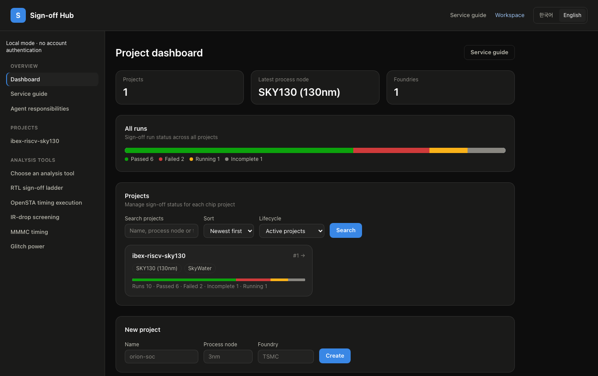
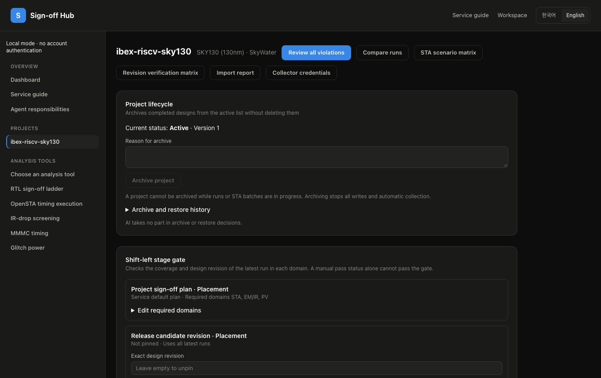
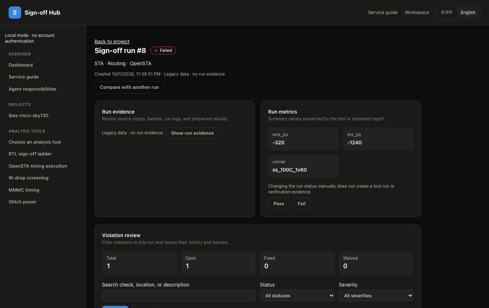
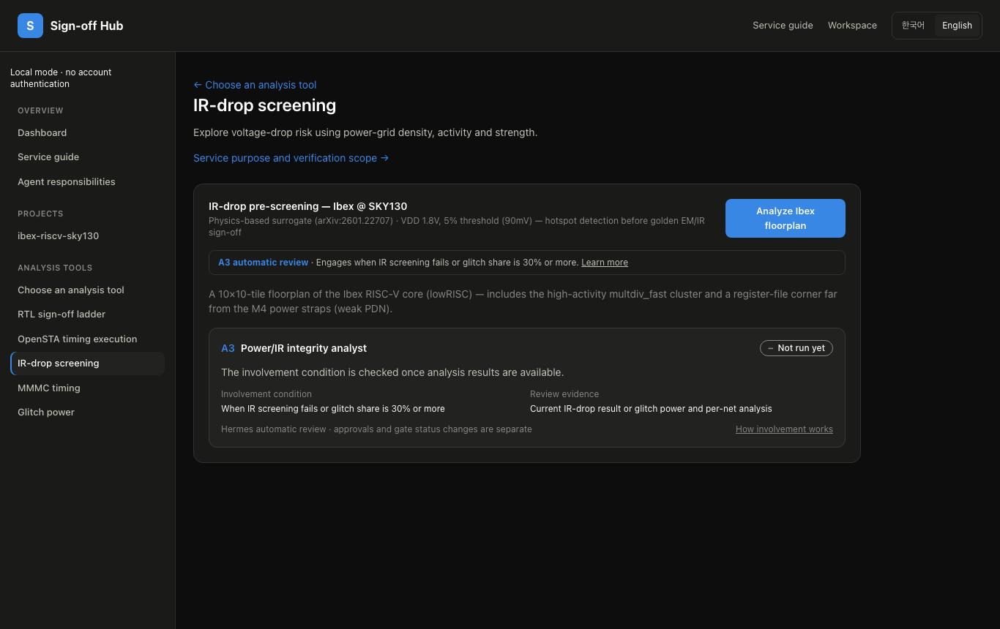

# Sign-off Hub
<p><a href="README.md" lang="ko">한국어</a> · <strong lang="en">English</strong></p>

A management and analysis platform for chip-design sign-off. It is an MVP that turns the latest
sign-off techniques from the `signoff-latest-tech-and-skills.md` research report (Korean) —
shift-left gates, IR-drop screening, vectorless glitch power, MMMC/PBA timing — into a runnable
full-stack application.

**Real-world example**: lowRISC **Ibex RISC-V core × SkyWater SKY130** (OpenROAD/OpenLane
reference-flow context — real Liberty corner names, VDD 1.8 V, SKY130 DRC rule names, Ibex
module/net names). The default example for the RTL sign-off ladder is the `cdc_status_bridge`
module, which contains bugs that are actually detected (an unsynchronized CDC crossing plus an FSM
dead-end), and it can be compared against a clean 2-FF synchronizer example with a single button.

## Quick start

```bash
# backend (http://127.0.0.1:8000, Swagger: /docs)
cd backend
uv venv --python 3.11 .venv && uv pip install --python .venv/bin/python --require-hashes -r requirements.txt
.venv/bin/python scripts/seed_demo.py        # seed the real Ibex example
.venv/bin/uvicorn app.main:app

# frontend (http://localhost:5173, /api → backend proxy)
cd frontend
pnpm install
pnpm dev
```

Tests: `cd backend && PYTHONPATH=. .venv/bin/python -m pytest` (1124 passing; the Linux memory-limit
checks are skipped on macOS)

The backend install pins the versions and hashes of all transitive dependencies. See the
[dependency install and update procedure](docs/dependencies.md) (Korean).

## Screens

Captured from the seeded Ibex × SKY130 demo with the UI switched to English.

<table>
  <tr>
    <td></td>
    <td></td>
  </tr>
  <tr>
    <td>Project dashboard — run status across all projects and per-project sign-off progress.</td>
    <td>Project detail — lifecycle, shift-left stage gate, sign-off plan and release-candidate revision.</td>
  </tr>
  <tr>
    <td></td>
    <td></td>
  </tr>
  <tr>
    <td>Sign-off run detail — run evidence, metrics (WNS/TNS, corner) and violation review.</td>
    <td>IR-drop screening — analysis tool with explicit agent-involvement status.</td>
  </tr>
</table>

## Structure

- `backend/` — FastAPI + SQLAlchemy + SQLite/PostgreSQL. Sign-off run / violation / waiver management,
  shift-left stage gates, four analysis APIs. The RTL sign-off ladder (verilator lint → CDC/reset/FSM
  design rules → yosys synthesis → SIGNED_OFF/CONDITIONAL/REJECTED) is a port of the deterministic
  verification modules from `~/gitspace/ai_driven_rtl`. A hermes-agent based six-role LLM analysis
  pipeline (`app/hermes.py`, `app/routers/agents.py`) is also included — details in
  `backend/README.md` (Korean).
- `frontend/` — Vite 7 + React 19 + TypeScript + Tailwind CSS v4 + TanStack Query + React Router 7.
  Dark theme only. Category-based sidebar navigation (overview / projects / analysis tools), run
  status and gate-readiness visualization, custom SVG charts (IR-drop heatmap, slack diverging bar,
  power stacked bar), and a review panel that shows explicitly whether an agent was involved.

## Service guide and screen layout

A login-free guide is available at `/guide/overview`. Korean / English can be selected from the common
header on every screen. The guide has five pages: service overview, where it sits in the development
flow, features and verification scope, agents and people, and getting started. The language is a
service-wide setting: the URL and any values being typed are preserved, and the same choice is used
when moving between the guide and the workspace. It carries over to the next visit and to other tabs.
The guide area opens without API access. Every screen in the guide and the workspace (project / run /
violation review, analysis tools, report import, account and security history, error messages) is
available in Korean and English, and dates are formatted for the selected language. Raw server error
text, tool logs and uploaded report contents are shown verbatim. The old per-language guide URLs
redirect to the common URL. English-coverage check: `scripts/browser_english_coverage_check.mjs`
([verification guide](docs/browser-verification.md), Korean).

Analysis-tool selection is at `/analysis`; individual tools are `/analysis/rtl`, `/analysis/sta`,
`/analysis/ir-drop`, `/analysis/timing` and `/analysis/glitch-power`. Legacy links such as
`/analysis#rtl-signoff` still resolve to the corresponding tool page. The guide can be reached from the
dashboard, the login screen and the sidebar.

## hermes-agent integration (optional)

A six-role pipeline (RTL reviewer → timing analyst → power/IR analyst → waiver examiner → sign-off
adjudicator → verification agent) is attached so that an LLM reviews RTL / timing / power-IR / gate
analysis results only when there are actual violations or anomalies. The exact involvement condition
of each role and the setup procedure are described in the "hermes-agent integration" section of
`backend/README.md` (Korean). When hermes is not running, the frontend degrades gracefully and shows
"agent not involved" / "involved — hermes not connected" states explicitly.

## CI

`.github/workflows/ci.yml` runs backend pytest + frontend build on every push/PR to `main`.
Dependabot checks backend (pip) / frontend (npm) / GitHub Actions dependencies weekly.

## Project violation review

All violations matching the applied search conditions, together with run and waiver information, can
be [exported as JSON](docs/violation-export.md) (Korean).

[Waiver scope and expiry](docs/waiver-scope-and-expiry.md) (Korean) ties each new approval to a design
revision and a validity period of at most 365 days, and feeds expiry and scope mismatches back into
gate blocking.
The project's **Review all violations** screen supports search, status, severity, stage and domain
filters plus paging. The default scope is the latest run per stage and domain; earlier runs can also
be selected. Search conditions and the selected item are preserved in the URL. For each violation the
fixed / waived / reopened reason and the handling history are recorded. In authenticated mode the
login account is used; in local mode a name entered directly is used.

Progress: [service improvement log](docs/service-improvement.md) (Korean).
Browser verification reproduction: [verification guide](docs/browser-verification.md) (Korean).

The run history in the project detail keeps full per-status totals while periodically refreshing only
the latest 50 runs. Older runs are loaded on request through cursor pages, so query cost does not keep
growing with the full history on long-running projects. The dashboard reads only per-project server
aggregates; run comparison starts from the latest 100 and adds older history on demand, and an old run
referenced in a shared URL is restored directly by ID.
In the project detail, server pages and aggregates can be narrowed together by domain, stage, status
and tool name.
Runs and status aggregates can also be narrowed by the exact value of a stored design revision, or by
"revision recorded" / "not recorded" ranges, with a recent-revision list offered as autocomplete.
The project's **Revision verification matrix** checks whether the selected revision has the required
domain results for each stage's sign-off plan, and shows on one screen the blocking reasons evaluated
with the same rules as the existing gate — coverage attestations, violations, waivers and MMMC plans.
Approvers can pin a release-candidate revision per stage. From then on the gate, evidence export and
approval package use only the latest runs of that revision; pinning and unpinning are versioned with
the reason and the actor. Approval is allowed only when a candidate is pinned and exactly matches the
gate's common revision.
Approvers first review the SHA-256 of the current evidence snapshot on screen; if the evidence changes
afterwards, the server rejects the approval and requires review of a new snapshot.
In deployments that require authentication, the current account password is re-confirmed when an
approve/block decision is submitted, and the confirmation time is bound to the decision hash and the
audit ledger.
Each new decision is linked to the SHA-256 of the previous decision and the project keeps a separate
chain head. The audit screen and API verify tampering of individual contents, deletion of an
intermediate decision, and deletion of the last decision.
The [portable decision audit ledger](docs/release-decision-ledger.md) (Korean) verifies the whole chain
outside the server using only standard Python, and can be compared with a separately stored chain head.
The dashboard receives accessible projects and run-status aggregates in a single API call, creating no
additional HTTP requests or evidence lookups proportional to the number of projects.
When there are many projects, name / process node / foundry are searched on the server, sorted by
registration date or name, and fetched 24 at a time. Search, sort and page are kept in the URL and
restored on share and refresh.
Completed projects can be archived by the owner with a reason. Archived projects leave the operational
list while retaining their existing evidence and audit history, and all writes, analysis runs and
collector submissions are blocked until restored.

## Run comparison

In the project's **Compare runs**, select two runs of the same domain and stage. Metric changes and
violations that were added, changed, or remain only in the baseline are shown side by side. The
selected run IDs and diff filter are stored in the URL. Comparison is read-only and does not treat
"not detected" as "fixed".

## STA scenario coverage

In the project's **STA scenario matrix**, the required corners / modes and whether SPEF is required can
be defined per stage. The actual OpenSTA server runs for a given design revision are compared against
the expected set to distinguish missing runs, missing SPEF requirements and unplanned runs. WNS and
violation counts are the path-sample range reported by OpenSTA; the fact that all scenarios have run is
not confused with full timing sign-off.

The MCMM batch in **OpenSTA timing execution** can load the expected set and assign Liberty / SDC / SPEF
per scenario. Up to 8 jobs are accepted into the server's persistent queue and executed sequentially in
a constrained container even if the browser is closed. If some scenarios fail the rest continue, and
each successful result is stored as an independent run with its input evidence. The batch submitter and
the per-item waiting / running / succeeded / failed / cancelled states remain in the DB manifest, so they
can be re-checked on the execution screen and in-progress jobs can be cancelled.
A finished batch can be re-run with identical inputs without re-uploading the validated inputs to the
server, preserving the original batch number and attempt number to trace result lineage.
Acceptance, worker start, per-scenario start/end, cancellation requests and the final state are kept as
a permanent timeline including actor and time, and can be audited on the execution screen.
OpenSTA uses a host concurrency pool separate from RTL. When several projects are waiting, projects with
no current run and the project that has waited longest for a slot are selected first to prevent slot
monopolization.

## RTL execution evidence

RTL analyses recorded on a project preserve the execution source, SHA-256, input revision, original
verdict and per-stage results together. They can be viewed in the run's **Show run evidence** and
downloaded as JSON. `CONDITIONAL` is stored as `incomplete` (verification not complete) and does not
open the RTL gate. Server analysis results are not overwritten by manual Pass/Fail or metric edits; they
are refreshed by re-running.

## Concurrent review protection

When a violation is handled, the change version that was read is checked as well. The case where
another reviewer changed the status and then reverted it is also detected as a conflict. The conflicting
reason is kept within the current browser tab so the change can be reviewed and re-submitted. Drafts are
not preserved across a tab refresh or close.

For API integration, send the `version` from the violation response as `expected_version` in fix /
waiver requests.

SQLite operational data supports online backup, verification and restore to a new path.
[Backup and recovery guide](docs/backup-recovery.md) (Korean)
[PostgreSQL operation](docs/postgresql.md) (Korean) explains connection settings, the scope of automatic
schema-upgrade verification, and the operational boundary of using PostgreSQL's own backup tools.

RTL testbench input, real Icarus execution, and preservation of compile / run logs and source hashes
are supported. [Testbench usage and server settings](docs/rtl-simulation.md) (Korean)

Login, project roles and account-based approval history are supported. The default local mode uses no
authentication; apply the [authentication settings](docs/authentication.md) (Korean) for production.

## Self-improvement loop

`python3 scripts/self_improve.py check` inspects the current state, and
`python3 scripts/self_improve.py run --max-iterations 3` repeats inspect → fix → regression verification
in an isolated workspace. Passing candidates and the accumulated patch are kept; with `--apply` the
patch is applied only if the original is unchanged since the start.
[Run / stop / verification-scope guide](docs/self-improvement-loop.md) (Korean)

In a project, [OpenSTA JSON report import](docs/report-import.md) (Korean) previews paths and slack and
stores the raw evidence and violations.
[PrimeTime / Tempus path JSON import](docs/commercial-sta-import.md) (Korean) validates the explicit
tool, version, time unit and pin list, and connects to the same path exploration, comparison and
violation review flow.
Submitting a [trusted collector coverage attestation](docs/coverage-attestation.md) (Korean) together
with an STA, CDC/RDC, DRC, LVS, LEC, DFT, low-power, EM/IR, power, thermal or RTL regression report
verifies the execution scope with the HMAC key registered on the server; unsigned reports continue to be
treated as partial evidence.
The [commercial EDA collector CLI](docs/collector-cli.md) (Korean) validates reports with the same
parsers and generates request JSON for direct submission to the server without exposing the secret key
on the command line or in output files.
In deployments that require authentication, collector Bearer credentials with project scope, expiry and
revocation can call only the eleven commercial report storage APIs without a browser session, and the
submitting identity is preserved in the execution evidence.
Before running, a collector can read the current stage's required domains, claims, submission paths and
MMMC plan version to align its automation settings with the server plan.
Project owners can issue a collector token once from the web and move it to a secret store, and manage
expiry / revocation state and the audit history of the issuing and revoking actors.
[Calibre / Pegasus DRC marker JSON import](docs/commercial-drc-import.md) (Korean) validates tool,
version, coordinate unit, severity and shapes, and connects to marker exploration and violation review.
[OpenLane 2 flow result import](docs/openlane-import.md) (Korean) creates per-corner STA, DRC / antenna /
XOR / PDN and LVS runs on the same revision from a single `final/metrics.json` or a failed run's
`state_out.json`, and connects them to cross-revision comparison. Being a flow summary, it does not open
a gate.
[Calibre / Pegasus LVS result import](docs/commercial-lvs-import.md) (Korean) validates layout /
schematic TOP and extracted counts, comparison verdict and mismatches, and connects them as independent
LVS evidence for the routing / final gates.
[Formality / Conformal LEC result import](docs/commercial-lec-import.md) (Korean) validates reference /
implementation compare points and equivalence failures, and connects them as independent logic
equivalence evidence for the synthesis / final gates.
[TestMAX / Tessent / Modus DFT result import](docs/commercial-dft-import.md) (Korean) recomputes scan
chain, DFT rule and per-fault-model ATPG coverage and pattern validation, and connects them as
independent DFT evidence for the synthesis / final gates.
[VC LP / Conformal Low Power result import](docs/commercial-low-power-import.md) (Korean) preserves UPF
power intent, power domains / states, and isolation / level shifter / retention / PG connection
findings as independent low-power evidence.
[RedHawk-SC / Voltus / Totem EM/IR result import](docs/commercial-emir-import.md) (Korean) validates the
values, limits, units and coordinates of voltage drop and current density, and connects them to hotspot
exploration and violation review.
[PrimePower / Joules / PowerArtist power result import](docs/commercial-power-import.md) (Korean)
re-verifies power component totals and glitch share, and connects them to hierarchical power exploration
and violation review.
[Celsius / Icepak / Calibre 3DSTACK thermal result import](docs/commercial-thermal-import.md) (Korean)
normalizes temperatures, limits and 3D positions, and connects them to thermal hotspot exploration and
violation review.
[VCS / Xcelium RTL regression result import](docs/commercial-rtl-import.md) (Korean) validates compile /
test / assertion aggregates and connects them to per-test log exploration and violation review.
[VC SpyGlass / Jasper CDC·RDC result import](docs/commercial-cdc-import.md) (Korean) validates clock /
reset domains, crossings and static findings, and connects them as independent CDC/RDC evidence for the
RTL gate.

For operational status checks and inquiry-number logs, see [operations](docs/operations.md) (Korean).

[Project sign-off plans](docs/signoff-plans.md) (Korean) manage the required domains per stage with
approver change reasons and append-only versions, and bind the same plan to gates, exports and decisions.
[Versioned STA scenario plans](docs/sta-scenario-plans.md) (Korean) preserve the required MMMC modes /
corners and SPEF requirements with approver history, and bind the plan version to collector signatures
and gates.
Stage gates do not open on a manual pass status alone; the design revision of the latest run per domain
is also checked.
For the verification scope and current support limits, see the
[gate provenance policy](docs/gate-provenance.md) (Korean).
[Sign-off decisions and evidence freeze](docs/signoff-release-decisions.md) (Korean) binds the approver's
approve / block reason and the verified ZIP package at that moment to a SHA-256 and stores them
immutably. When the current runs, waivers or plans change, past decisions are marked
`evidence changed · re-decision required`.

[KLayout DRC marker report import](docs/klayout-import.md) (Korean) is supported. Markers are preserved
as PV runs, violations and raw evidence, and are distinguished from a full DRC pass.

## License

MIT — see [LICENSE](LICENSE).
