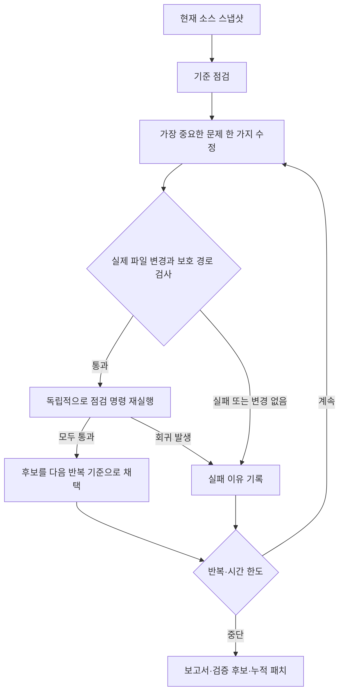

# 자기 개선 루프

이 저장소의 개발 루프입니다. 현재 소스(미커밋·추적되지 않은 파일 포함)를 별도 작업 공간에
복사하고 **점검 → 한 가지 수정 → 회귀 검증 → 채택 또는 제외 → 다음 반복**을 수행합니다.
기본 설정은 백엔드 pytest와 프런트엔드 빌드를 실행합니다.

## 사용

저장소 루트에서 먼저 점검합니다. 이 명령은 모델을 호출하지 않습니다.

```sh
python3 scripts/self_improve.py check
```

Codex CLI가 설치되고 로그인된 환경에서 실제 수정 루프를 실행합니다.

```sh
python3 scripts/self_improve.py run --max-iterations 3 \
  --goal '권한 관리 화면의 실제 오류 한 가지를 찾아 수정하고 회귀 근거를 남겨라'
```

기본 명령은 `codex exec --sandbox workspace-write --json --output-last-message ... -`이며,
프롬프트를 stdin으로 전달합니다. 설치된 CLI의 인증 설정을 사용합니다.
근거: [OpenAI 공식 비대화형 실행 문서](https://learn.chatgpt.com/docs/non-interactive-mode).
CLI가 없거나 인증·실행에 실패하면 실패로 기록하며 권한 제한을 우회해 재실행하지 않습니다.

기본값은 **후보와 패치 생성**입니다. 실행 중인 개발 서버와 원본 저장소를 변경하지 않습니다.
검증된 패치를 원본에도 자동 반영하려면 실행 시 명시적으로 선택합니다.

```sh
python3 scripts/self_improve.py run --max-iterations 3 --apply \
  --goal '검증된 실패를 한 가지 수정하라'
```

`--apply`는 시작 시점의 원본 파일 지문이 그대로일 때만 적용합니다.
사용자가 중간에 수정하거나 새 파일을 추가했다면 패치를 남기고 적용을 중단합니다.
원본 Git 커밋, push, PR 병합, 배포 명령은 실행하지 않습니다.
현재 개발 서버가 자동 리로드 중이면 원본에 적용한 코드가 서버에 반영됩니다.

## 반복과 중단 규칙



- 한 번에 기본 3회, 전체 실행 예산 1,800초, 개별 외부 명령 600초입니다.
  `--max-iterations`, `--max-seconds`, `--command-timeout`으로 조정합니다.
- 2회 연속 수정 실패·회귀·보호 파일 변경·변경 없음이면 멈춥니다(`--stop-after`).
- 실패한 후보는 다음 반복의 코드 기준으로 사용하지 않고 실패 로그만 피드백으로 넘깁니다.
- 검증 명령이 소스 파일을 바꿔서 통과시키는 경우도 거부합니다.
- Ctrl+C와 명령 시간 초과 시 실행 프로세스 그룹을 정리합니다. 로그는 8 MiB로 제한합니다.
  Git 보조 명령은 별도 30초 제한이며 스냅샷/정리 시간까지 정확한 실시간 상한을 보장하지는 않습니다.
- 파일 잠금으로 같은 저장소의 루프가 동시에 실행되는 것을 차단합니다.
- `checks_passed`는 점검 성공, `verified_candidate`는 설정된 회귀 검증을 통과한 후보입니다.
  이는 기능 완성이나 전체 상용화 목표 달성을 증명하는 상태가 아닙니다.

## 점검과 보호 설정

`improvement-loop.json`에 목표, 고정 점검 명령, 보호 경로를 정의합니다.
명령은 셸 문자열이 아닌 argv 배열이고, cwd는 후보 작업 공간 안으로 제한합니다.
기존 테스트·CI·루프 자체·의존성 정의를 기본 보호하여 모델이 검증 기준을 낮추지 못하게 합니다.
기능별 합격 기준을 자동으로 판정하려면 실행 전에 해당 동작을 검사하는 명령을 checks에 추가하세요.
기본 pytest/빌드는 모바일·접근성·실제 툴 결과·배포의 전체 검증을 대신하지 않습니다.

CI 백엔드는 Ubuntu 24.04에서 Icarus·Verilator·Yosys를 설치하고, `iverilog`, `vvp`,
`verilator`, `yosys` 실행 파일과 버전 명령을 먼저 확인합니다. 도구가 없으면 테스트 전에
실패하므로 실제 RTL 테스트가 미설치로 건너뛰어진 채 CI가 통과하지 않도록 합니다.
pytest의 `-ra` 옵션으로 건너뛴 테스트 등 결과 사유도 출력합니다.
로컬 루프는 도구를 자동 설치하지 않으므로 실제 RTL 검증이 필요한 환경에서는 동일한 도구를
설치한 뒤 실행해야 합니다.

패키지 근거: Ubuntu 24.04의 [Icarus](https://packages.ubuntu.com/noble/iverilog),
[Verilator](https://packages.ubuntu.com/noble/verilator),
[Yosys](https://packages.ubuntu.com/fr/noble/yosys).

`.env` 계열(예제 파일 제외), DB 파일과 Git ignore 대상은 스냅샷에서 제외합니다.
설치된 backend `.venv`, frontend `node_modules`는 공유 링크로 사용하므로 의존성 설치/변경은
루프 밖에서 수행합니다. 이 실행 환경은 신뢰된 로컬 저장소용이며 악성 코드용 OS 격리가 아닙니다.
검증 환경에 상속된 OpenAI API 키, SIGNOFF 설정, PYTHONPATH·pytest 추가 옵션을 제거합니다.
Git 작업 경로를 바꾸는 환경변수도 제거합니다. 파일 잠금과 프로세스 제어는 POSIX 환경을 대상으로 합니다.
사용자 지정 `--agent-command`는 JSON argv 배열이며, 신뢰하는 어댑터/테스트 도구에만 사용합니다.

## 결과와 기록

`.self-improve/<실행 ID>/` 아래에 다음 파일을 남깁니다. 디렉터리는 Git에서 제외하고 0700으로 제한합니다.

- `report.json`: 기준 점검, 반복별 명령 종료 코드, 변경 경로, 거부 이유, 채택 수와 종료 상태
- `baseline/`: 시작 시 소스 스냅샷
- `iteration-N/workspace/`: 각 수정 후보
- `iteration-N/agent.log`, `check-N.log`, `agent-summary.txt`: 실행 증거와 모델 설명
- `candidate/`, `changes.patch`: 검증된 변경이 있을 때만 생성하는 누적 결과

이전 보고서를 새 목표에 인용하거나 별도 점검 명령을 추가해 다음 실행에 반영할 수 있습니다.
현재 자동 피드백은 한 실행 안의 반복을 대상으로 하며, 실행 간 영구 학습·모델 가중치 수정은 하지 않습니다.
실패한 후보와 로그를 모델 설명과 함께 보존하므로 같은 실패를 다시 조사할 때 근거를 사용할 수 있습니다.

## 검증 범위

실제 저장소의 기준 점검을 실행하고, 별도의 작은 결함 저장소에서 수정 어댑터로
실패→수정→통과→패치 생성, 회귀 거부, 보호 파일 거부, 진전 없음 중단,
명령 시간/로그 한도, 소스 보존, 동시 편집 시 적용 차단을 검증합니다.
실제 Codex 모델을 호출한 자동 수정 실행은 이 구현 검증에 포함하지 않았습니다.
`run`은 CLI의 모델 호출과 사용량을 발생시키며 예약·무한 백그라운드 실행은 기본으로 설정하지 않습니다.
